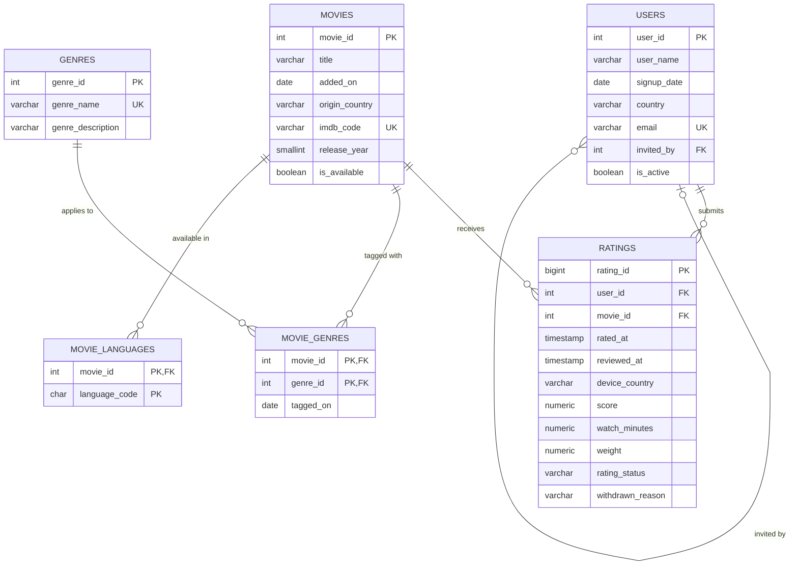

# CineRate: A Movie & TV Show Rating Platform

**A PostgreSQL analysis of a movie-rating platform, tracing whether failed (withdrawn) ratings are getting better or worse, which titles drive them, and what the team should do next.**

*EX 603: Data Algorithms for Scalable Systems, course project.*

## The domain

CineRate is a platform that helps people decide what to watch by aggregating ratings from a community of viewers. It tracks the catalog (titles, release years, genres, languages, availability), registered users, and every rating those users submit. Each rating carries a score, a timestamp, the country of the device it came from, and a moderation status.

To be useful, the platform has to answer questions at three levels. For a **title**: what is its average score, how many people rated it, and are its ratings trustworthy? For a **user**: what have they rated, and who are the people behind suspicious activity? For the **platform**: is rating quality improving or getting worse over time, and where should the team spend its moderation and catalog effort?

The thread running through this project is a *failure rate*. A rating is a failure when its `rating_status` is `withdrawn` (removed for spam, a policy violation, duplication or user request). Over six units the analysis went from checking that the number could be trusted, to splitting it by movie and region, to naming the movies and users behind it, and finally to tracking it over time with window functions.

## Database overview

The analysis runs on the course-provided dataset (`ex603_data`): 200 ratings of 15 movies by 30 users during 2023. The DDL and data are in [`schema/ex603_data.sql`](schema/ex603_data.sql).



Tables used in the analysis:

- **`ratings`** is the event table. `score` is the metric, `rating_status` (`published`, `flagged`, `withdrawn`) defines failure, `withdrawn_reason` explains it, and `device_country` is the region. Withdrawn ratings carry a **0.5 placeholder score**, so every average in this project excludes them.
- **`movies`** holds the producers. `is_available` marks titles removed from browsing. It stores only the current value, not its history, which became a key limitation (see below).
- **`users`** holds the actors behind each rating.
- **`movie_genres`** and **`genres`** link movies to genre tags (many-to-many). They were used in Unit 5 to look for shared traits among the flagged movies.

My own earlier schema design from Unit 2 (five tables, Mermaid ERD) is kept in [`schema/schema.sql`](schema/schema.sql) and [`schema/erd.mmd`](schema/erd.mmd) for reference.

## Query catalogue

Every `.sql` file opens with a comment naming the task and the question it answers.

### Unit 3: Filtering and data checks

| # | Query | Business question it answers | Location |
|---|---|---|---|
| 3.1 | Active, highly rated movies (filter, sort, `LIMIT 10`) | Which titles are both available and well rated? | [`q3_1.sql`](queries/unit3/q3_1.sql) |
| 3.1 | Distinct rating statuses | What states can a rating be in? Are there more than expected? | [`q3_1.sql`](queries/unit3/q3_1.sql) |
| 3.1 | Range filter and `IN` list | Which ratings fall in a score range or a set of statuses? | [`q3_1.sql`](queries/unit3/q3_1.sql) |
| 3.1 | `LIKE`, `IS NULL`, `COALESCE` | Which titles match a pattern, and which ratings have no withdrawn reason? | [`q3_1.sql`](queries/unit3/q3_1.sql) |
| 3.1 | Computed, labelled columns | How can ratings be presented to a non-SQL reader? | [`q3_1.sql`](queries/unit3/q3_1.sql) |
| 3.2 | Counts with NULL-safe filters; alias in `WHERE` | Why does `withdrawn_reason != 'Spam detected'` silently drop NULL rows? | [`q3_2.sql`](queries/unit3/q3_2.sql) |
| 3.3 | Subquery on flagged ratings | Which users were involved in a disputed rating? | [`q3_3.sql`](queries/unit3/q3_3.sql) |

### Unit 4: Aggregation

In these queries, the event table is `ratings`, the metric is `score`, the producer is a movie, the actor is a user, and region is `device_country`. A *failure* is a rating with `rating_status = 'withdrawn'`.

| # | Query | Business question it answers | Location |
|---|---|---|---|
| 4.1.1 | Whole-table summary of `score` (count, total, average, min, max, distinct users) | What does the rating pool look like overall, and how many people contribute to it? | [`q4_1.sql`](queries/unit4/q4_1.sql) |
| 4.1.1b | Missing-score check | Are any ratings missing a score? | [`q4_1.sql`](queries/unit4/q4_1.sql) |
| 4.1.1c | Score range by rating status | Is any group of ratings distorting the metric? (Withdrawn ratings all carry a 0.5 placeholder.) | [`q4_1.sql`](queries/unit4/q4_1.sql) |
| 4.1.1d | Whole-table summary excluding withdrawn ratings | What does the rating pool look like when only genuine ratings are counted? | [`q4_1.sql`](queries/unit4/q4_1.sql) |
| 4.1.2 | Rating count and average score per movie (`LEFT JOIN` keeps unrated movies) | Which movies get the most attention, and does attention line up with how well they are rated? | [`q4_1.sql`](queries/unit4/q4_1.sql) |
| 4.1.2b | Same, excluding withdrawn ratings | How do movies compare once placeholder scores are removed? | [`q4_1.sql`](queries/unit4/q4_1.sql) |
| 4.1.3 | Withdrawn rate per movie, `HAVING COUNT(*) >= 10` | Which movies have enough ratings for their failure rate to be trusted, and what is that rate? | [`q4_1.sql`](queries/unit4/q4_1.sql) |
| 4.1.4 | Ratings, average score and withdrawn rate by region × release era | How does performance differ across regions and between newer and older titles? | [`q4_1.sql`](queries/unit4/q4_1.sql) |
| 4.2 A | Total and withdrawn ratings per movie in one pass (`SUM(CASE ...)`) | For each movie, how many ratings were withdrawn? | [`q4_2.sql`](queries/unit4/q4_2.sql) |
| 4.2 B | Regional subtotals and grand total (`GROUPING SETS`) | How does each region compare with the platform as a whole? | [`q4_2.sql`](queries/unit4/q4_2.sql) |
| 4.2 C | Two-step baseline (`WITH` per-movie summary, then movies with 10+ ratings) | What is a typical withdrawal rate for a high-volume movie? | [`q4_2.sql`](queries/unit4/q4_2.sql) |

### Unit 5: Joins

| # | Query | Business question it answers | Location |
|---|---|---|---|
| 5.1.1 | `users JOIN ratings JOIN movies` | Who submitted each rating, for which movie, and when? | [`q5_1.sql`](queries/unit5/q5_1.sql) |
| 5.1.2 | Genre overlap through `movie_genres` | Do the flagged movies (2, 9, 11) share a genre tag? | [`q5_1.sql`](queries/unit5/q5_1.sql) |
| 5.1.3 | Self-join on origin country and release era | Do the flagged movies have peers, and how does their activity compare? | [`q5_1.sql`](queries/unit5/q5_1.sql) |
| 5.2 A | `LEFT JOIN` vs `INNER JOIN` | Which movies disappear from an inner-join report, and why? | [`q5_2.sql`](queries/unit5/q5_2.sql) |
| 5.2 B | `RIGHT JOIN`, `FULL OUTER JOIN` | Do the join directions agree, and which rows are unmatched on either side? | [`q5_2.sql`](queries/unit5/q5_2.sql) |
| 5.2 C | `NOT EXISTS`, `EXCEPT` | Which movies have never been rated? | [`q5_2.sql`](queries/unit5/q5_2.sql) |
| 5.3 A | `CROSS JOIN` with row-count check | What does a Cartesian product look like, and when is it a bug? | [`q5_3.sql`](queries/unit5/q5_3.sql) |
| 5.3 B | `EXPLAIN ANALYZE` on the three-table join | How does PostgreSQL execute the join? | [`q5_3.sql`](queries/unit5/q5_3.sql) |

### Unit 6: Window functions

| # | Query | Business question it answers | Location |
|---|---|---|---|
| 6.1.1 | `AVG() OVER (PARTITION BY movie_id)` vs `GROUP BY` | Is each rating unusual for its own movie? | [`q6_1.sql`](queries/unit6/q6_1.sql) |
| 6.1.2 | `ROW_NUMBER`, `RANK`, `DENSE_RANK` side by side | How should a most-rated leaderboard treat tied movies? | [`q6_1.sql`](queries/unit6/q6_1.sql) |
| 6.1.3 | `NTILE(4)` | Which activity band is each movie in, and do ties get split? | [`q6_1.sql`](queries/unit6/q6_1.sql) |
| 6.2 A | `LAG`, `LEAD` and a delta for Movie 11 | Are a movie's scores rising or falling from one rating to the next? | [`q6_2.sql`](queries/unit6/q6_2.sql) |
| 6.2 B | Running total vs a 240-rating target; 30-day moving averages | Where does the platform stand, and how is it trending recently? | [`q6_2.sql`](queries/unit6/q6_2.sql) |
| 6.2 C | `LAG` gap detection in a CTE | Which movies stopped receiving ratings for a long stretch? | [`q6_2.sql`](queries/unit6/q6_2.sql) |
| 6.3 A | Top 3 published ratings per movie with `FIRST_VALUE` | What should a movie's "Top Reviews" panel show? | [`q6_3.sql`](queries/unit6/q6_3.sql) |
| 6.3 B | Monthly series with `LAG`, `NULLIF` and a missing-month check | Is the platform getting better or worse each month? | [`q6_3.sql`](queries/unit6/q6_3.sql) |

Write-ups: [`analysis/`](analysis/) contains one write-up and one finding memo per unit. The final answer to leadership is [`analysis/unit6-finding.md`](analysis/unit6-finding.md).

## Technical highlights

1. **Separating real scores from placeholders (Unit 4).** A score-range-by-status query showed that every withdrawn rating carries a 0.5 placeholder. Averages that include them make high-withdrawal movies look worse than viewers actually rated them, so every later average uses only non-withdrawn (or only published) scores.
2. **Conditional aggregation (Unit 4).** `SUM(CASE WHEN rating_status = 'withdrawn' THEN 1 ELSE 0 END)` counts ratings and failures in a single pass with no `WHERE`, so totals and rates come from the same rows. `HAVING COUNT(*) >= 10` keeps small samples from topping the failure-rate list.
3. **Outer and anti-joins (Unit 5).** `LEFT JOIN`, `NOT EXISTS` and `EXCEPT` surfaced Movies 14 and 15, which have zero ratings and silently vanish from any inner-join report. That changes a catalog decision, because those titles need a discoverability check, not a quality review.
4. **Window functions over a gap-free calendar (Unit 6).** Before computing moving averages, `generate_series` plus a `LEFT JOIN` gives every calendar day a row, with zero-rating days counted as 0. Without it, `ROWS BETWEEN 29 PRECEDING` would span far more than 30 days and overstate activity.
5. **Deterministic ranking (Unit 6).** Every `ORDER BY` inside a window ends with a unique tiebreaker (`rated_at, rating_id`). In this data, four movies have 4–6 ratings tied at a perfect 5.0, so without the tiebreaker the "Top 3" panel could change from run to run.

## Findings and recommendations

1. **The failure rate improved after Q1, then stalled.** Withdrawn ratings fell from 22.6% in Q1 to 14.6% in Q2 and stayed around 15% for the rest of 2023. **Recommendation:** keep the moderation in place since Q1, aim it at spam (the leading reason in both halves of the year), and target under 12% next quarter.
2. **The problem is concentrated in a few titles, and one is getting worse.** Movies 11, 9 and 2 had the highest withdrawal rates (Unit 4). Movies 11 and 2 improved in the second half, but Movie 9 went from 1 withdrawal to 3, and it also had the year's longest silence: 112 days without a rating. **Recommendation:** move Movie 9 to the front of the moderation queue, and confirm whether it was unavailable between January and April.
3. **Two titles have never been rated, and volume is below target.** Movies 14 and 15 have no ratings, despite being in the catalog for over a year (Unit 5), and the platform reached 200 of a 240-rating target (83%). **Recommendation:** check discoverability for the unrated titles before deciding whether to promote or retire them.

## Limitations and future improvements

**Availability has no history.** `movies.is_available` stores only today's value, so the analysis cannot tell whether a gap like Movie 9's was a real drop in interest or a period when the title was pulled from the catalog. Adding an `availability_history` table (movie, from date, to date, reason) would let gap detection separate the two. A second limitation is **sample size**: at 11–21 ratings per month, one withdrawal moves a monthly rate by about 9 points. A larger dataset, or quarterly reporting as used here, is needed before month-level changes can be trusted.

## Video presentation

▶️ **[Watch the 5-minute walkthrough](VIDEO_URL_HERE)**

## How to run it

Requirements: PostgreSQL 14 or later, with `createdb` and `psql` on your path.

```bash
# 1. Create the database and load the schema + data
createdb ex603_data
psql -d ex603_data -f schema/ex603_data.sql

# 2. Run any query file, for example the Unit 6 window-function queries
psql -d ex603_data -f queries/unit6/q6_1.sql
```

Each file can also be opened in any SQL client (pgAdmin, DataGrip, DBeaver) connected to `ex603_data`. Screenshots of each query and its results are in [`screenshots/`](screenshots/).
